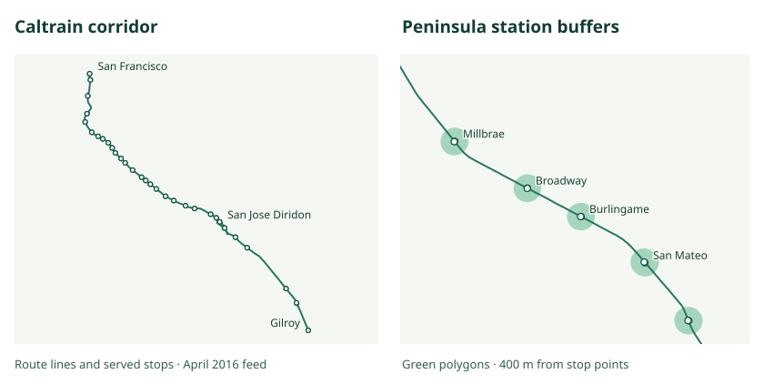
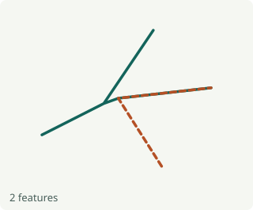
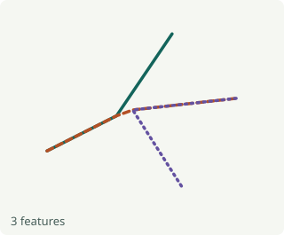
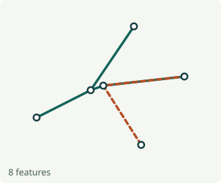
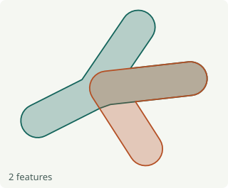
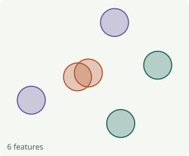
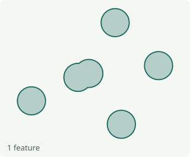
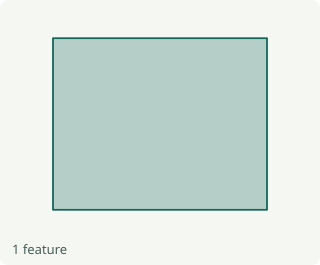

# GTFS-to-GeoJSON

<p align="center"></p>

Export a GTFS Schedule feed as GeoJSON layers for QGIS, web maps and spatial analysis. By default you get a route line layer and a served stop point layer for each input source. You can also export individual trip shapes, GTFS Flex service areas, buffers and dissolved coverage polygons.



[Browse example GeoJSON](examples/caltrain) · [Web version](https://geojson.gtfstohtml.com) · [Migrate from v3](docs/migrating-to-v4.md)

## Quick start

Use Node.js 22.18+ on the 22.x line, or Node.js 24+. These examples use a local GTFS zip. An extracted feed directory also works.

```sh
npx gtfs-to-geojson --input ./gtfs.zip --source-id metro
```

Open `geojson/metro/route-lines.geojson` or `geojson/metro/stop-points.geojson` in your GIS. Each file is a GeoJSON FeatureCollection in longitude, latitude order. For one file containing both, pass `--layer network`.

```sh
# Export actual shape paths and stop points for each route and direction
npx gtfs-to-geojson --input ./gtfs.zip --output ./directions \
  --group-by route-direction --layer shape-lines --layer stop-points

# Export from an existing node-GTFS v5 database
npx gtfs-to-geojson --database ./transit.sqlite --source-id metro \
  --service-date 20260914 --layer stop-coverage --output ./coverage
```

Use `--url` for a remote archive. The CLI reads `./config.json` if present, or the file given by `--config`. CLI options override the file. Direct input replaces the source list. Relative paths resolve from the working directory. Progress and warnings go to stderr. Help and version go to stdout. Run `gtfs-to-geojson --help` for all flags.

## Configuration

Copy [config-sample.json](config-sample.json) to `config.json`, set the feed location, and run `gtfs-to-geojson`. [config-sample-full.json](config-sample-full.json) shows two sources, a persistent database and multiple layers.

```json
{
  "sources": [{ "sourceId": "metro", "schedule": { "path": "./gtfs.zip" } }],
  "export": {
    "outputDirectory": "./maps",
    "groupBy": "route",
    "layers": ["route-lines", "stop-points"]
  }
}
```

The shared `database`, `sources[].schedule`, `extensions` and `reporting` groups use [node-GTFS v5 instance and Schedule options](https://github.com/BlinkTagInc/node-gtfs/blob/main/docs/configuration.md). For example, put HTTP headers in `schedule.requestHeaders` and duplicate handling in `schedule.import.validation.onDuplicateKey`. Enable GTFS+ explicitly with `"extensions": ["gtfs-plus"]`.

A source with a schedule imports before export. A source containing just `sourceId` reads previously imported data. The database defaults to in-memory SQLite. One source can omit its ID and use `default`. Multiple sources require distinct IDs. Set `export.sourceId` to select one.

| Export option        | Default                          | Meaning                                                                                                                                                                                           |
| -------------------- | -------------------------------- | ------------------------------------------------------------------------------------------------------------------------------------------------------------------------------------------------- |
| `outputDirectory`    | `./geojson`                      | Dedicated destination containing one subdirectory per source.                                                                                                                                     |
| `groupBy`            | `source`                         | `source`, `route`, `route-direction` or `shape`.                                                                                                                                                  |
| `layers`             | `["route-lines", "stop-points"]` | One file per selected layer in each group.                                                                                                                                                        |
| `serviceDate`        | All service                      | Numeric YYYYMMDD or an inclusive range such as `{ "start": 20260101, "end": 20260131 }`. Either endpoint may be omitted. Selects trips active on any matching day, including calendar exceptions. |
| `bufferRadiusMeters` | `400`                            | Distance from the original point or line to the edge of its buffer.                                                                                                                               |
| `coordinateDecimals` | Full precision                   | Round coordinates after spatial operations. Five decimal places work well for most route and stop maps.                                                                                           |
| `archive`            | `false`                          | Also write `geojson.zip`, preserving the layer paths.                                                                                                                                             |
| `overwrite`          | `false`                          | Replace a previous export after generation succeeds. An unrelated file in the output directory blocks replacement.                                                                                |

With `coordinateDecimals: 5`, rounding can shift a point by less than one meter. Use `6` when nearby features need to remain distinct at sub-meter scales, such as detailed platform or service-area boundaries. Omit the option to preserve the original coordinate precision. [GeoJSON precision guidance](https://datatracker.ietf.org/doc/html/rfc7946#section-11.2)

For example, a route-direction export writes `metro/route-direction/R/0/stop-points.geojson`. Trips with a blank direction use `unspecified`. Unsafe filename characters and case collisions get a hash suffix. The original IDs remain in feature properties. The output manifest lists generated files relative to the destination.

## Layers

The maps show the same illustrative feed at the same scale. It has two fixed routes, three shapes, six stops and one Flex zone. The buffers use a 400-meter radius. Select a layer name to inspect its GeoJSON.

| Layer                                                                                  | Example                                                                                                                        | What each feature represents                                                                                                                             |
| -------------------------------------------------------------------------------------- | ------------------------------------------------------------------------------------------------------------------------------ | -------------------------------------------------------------------------------------------------------------------------------------------------------- |
| [`route-lines`](examples/gallery/route-lines.geojson)<br>MultiLineString               |                                      | One feature per route. Route A includes both of its branches. Shared segments appear once within each route.                                             |
| [`shape-lines`](examples/gallery/shape-lines.geojson)<br>LineString                    |                       | One feature per original GTFS shape, preserving point order. The two variants of route A appear as separate features.                                    |
| [`stop-points`](examples/gallery/stop-points.geojson)<br>Point                         |                                             | One feature per served stop with coordinates. Each point lists its serving routes.                                                                       |
| [`network`](examples/gallery/network.geojson)<br>MultiLineString and Point             |                                       | Route lines and served stop points in a single collection.                                                                                               |
| [`route-buffers`](examples/gallery/route-buffers.geojson)<br>Polygon or MultiPolygon   |                              | One 400-meter buffer per route. Overlapping routes retain separate polygons.                                                                             |
| [`route-coverage`](examples/gallery/route-coverage.geojson)<br>Polygon or MultiPolygon |                        | Route buffers dissolved into one feature per group. The shared corridor has one boundary.                                                                |
| [`stop-buffers`](examples/gallery/stop-buffers.geojson)<br>Polygon or MultiPolygon     |       | One 400-meter buffer per stop. Nearby stops have overlapping circles.                                                                                    |
| [`stop-coverage`](examples/gallery/stop-coverage.geojson)<br>Polygon or MultiPolygon   |  | Stop buffers dissolved into one feature per group. Nearby circles merge and isolated areas remain separate parts.                                        |
| [`bounding-box`](examples/gallery/bounding-box.geojson)<br>Polygon                     |                        | The smallest axis-aligned rectangle containing the route lines.                                                                                          |
| [`convex-hull`](examples/gallery/convex-hull.geojson)<br>Polygon                       |                  | The smallest convex polygon enclosing the served stops. Its edges connect the outermost stops.                                                           |
| [`service-areas`](examples/gallery/service-areas.geojson)<br>Polygon or MultiPolygon   |              | A GTFS Flex zone supplied in <code>locations.geojson</code>. Grouped and date-filtered exports select zones through <code>stop_times.location_id</code>. |

When a trip lacks usable shape geometry, route-line layers connect its ordered stop coordinates. Actual shape layers contain only shapes from the feed. Stop and shape metadata retain the serving-route list from node-GTFS, even when a filter selects fewer trips. Empty layers are valid empty FeatureCollections. A degenerate hull or bounding box emits a warning.

## JavaScript and TypeScript

```sh
pnpm add gtfs-to-geojson
```

<!-- prettier-ignore -->
```js
import { exportGeoJSON } from 'gtfs-to-geojson';

const { outputDirectory, files } = await exportGeoJSON({
  sources: [{ sourceId: 'metro', schedule: { path: './gtfs.zip' } }],
  export: { outputDirectory: './maps', layers: ['stop-coverage'] },
});

console.log(outputDirectory, files); // files includes metro/stop-coverage.geojson
```

The API returns `{ outputDirectory, files, archivePath? }` and rejects on failure. It is silent unless you pass a node-GTFS reporter in `reporting.reporter`. TypeScript callers can import `GeoJSONConfig`, `GeoJSONExportOptions`, `GroupBy` and `Layer`.

## Examples and development

The [Caltrain examples](examples/caltrain) were generated from the April 2016 test feed. Compare the four route features with the eight raw shape features, or inspect the 64 stop buffers beside their single dissolved coverage feature. Regenerate the Caltrain examples and the layer gallery with `pnpm run examples` from a checkout.

[SFMTA benchmark](docs/performance.md) · [Contributing](CONTRIBUTING.md) · [Changelog](CHANGELOG.md) · [MIT license](LICENSE.txt)
